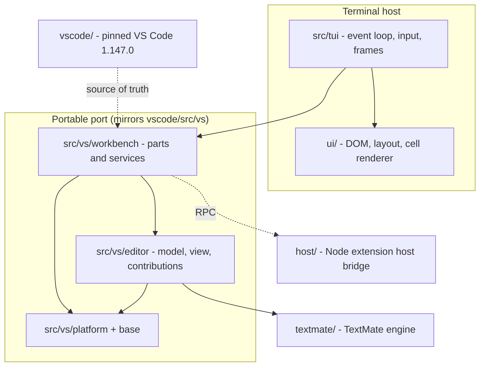

<div align="center">

# minecode

**VS Code's editor and workbench internals, ported to Zig — in your terminal.**

[](https://github.com/chendesheng/minecode/actions/workflows/ci.yml)
[](https://github.com/chendesheng/minecode/releases)
[](https://chendesheng.github.io/minecode/)
[](https://ziglang.org/)
[](LICENSE)
[](https://github.com/chendesheng/minecode/releases)

</div>

Terminal editors are usually written from scratch, so they inherit neither VS
Code's editing model nor its ecosystem. **minecode** takes the other route: port
the real editor, workbench and extension host, and replace only the browser
surface with a terminal cell grid.

The model/view/view-model layers, workbench services, registries, contributions,
settings, theming, keybindings and the Node extension host are ported from a
pinned VS Code 1.147.0 tree into Zig 0.17. Upstream files are never modified;
behavior lives at the mirrored path under `src/vs/` and `src/extensions/`. A
POSIX pty, libghostty-vt and a standalone cell-based UI library replace the
browser at the edge. It is a native app, not a web wrapper.

> **Live demo** — [open the native workbench in your browser](https://chendesheng.github.io/minecode/).
> The page boots a real Linux kernel (unkernel), runs the native aarch64 binary
> on a pty and renders it with Ghostty. The extension host and Git are not
> included in the demo.

## What works

| | |
| --- | --- |
| **Editor** | TextMate grammars and VS Code themes, soft wrap, folding, sticky scroll, bracket-pair colorization and guides, multi-cursor, find/replace, suggest and snippets, hover, comments, indentation and in-place replace. |
| **Workbench** | Activity bar, side bar, panel and status bar; tabs and split editor groups with drag and drop; quick open and command palette; breadcrumbs, outline and Problems; notifications, settings, keybindings, session restore and zen mode. |
| **Navigation** | Explorer with exclude/ignore filtering and sticky folders; ripgrep search and Search Editor; Source Control over the Git CLI with Changes and commit Graph; quick diff and a side-by-side/inline diff editor. |
| **Extensions** | Extensions side panel and detail editor, Open VSX Marketplace search, VSIX installation, updates, version/channel selection, dependency packages and global/workspace enablement. The real pinned Node extension host provides TypeScript/JavaScript, JSON, Zig/ZLS, Git, Emmet, task providers, authentication, Simple Browser and Copilot. See [usage and limitations](docs/usage.md#extensions-side-panel). |
| **Modal editing** | Compiled-in Vim and Helix engines that share the editor's selection, undo and key-dispatch state. No Vimscript, plugins or `.vimrc`; see [vim.md](docs/vim.md) and [helix.md](docs/helix.md). |
| **Terminal** | Bottom-panel or editor-area shells backed by a real POSIX pty and libghostty-vt: tabs, split groups, profiles, shell integration (OSC 133/7), mouse and focus reporting, bracketed paste. |
| **Terminal UI** | The standalone [`ui`](ui/README.md) package: DOM-like tree, style cascade, box layout, UAX #14 wrapping, cell renderer with ANSI frame diff, kitty images, OSC 22 pointer shapes, cell borders and themed widgets. |
| **Porting model** | `src/vs/` mirrors upstream paths and never imports `src/tui/`; `ui/` and `textmate/` never import `src/`. Upstream source is read-only; deviations are documented in file headers and design notes. |

## Quick start

**Prebuilt binaries.** Tagged releases ship Linux (x86_64 and aarch64 musl),
macOS (Apple Silicon) and Windows (x86_64) archives. Download one from
[Releases](https://github.com/chendesheng/minecode/releases), extract it and run
`bin/minecode <folder>`. Keep the sibling `bin/`, `share/` and `lib/`
directories together; see [docs/usage.md](docs/usage.md#install-layout).

**From source.** Requires Zig 0.17 or newer and Oniguruma.

```sh
git clone --recurse-submodules --shallow-submodules https://github.com/chendesheng/minecode.git
cd minecode

brew install oniguruma                    # macOS
sudo apt install libonig-dev              # Debian/Ubuntu

zig build -Doptimize=ReleaseSmall
zig build run -- ~/code/project
```

`zig build` alone produces a Debug build with the system libonig;
`-Donig-static=true` links the vendored Oniguruma instead. The optional Node
host and language servers are built with `zig build host` and
`zig build json-server`; see
[docs/usage.md](docs/usage.md#node-extension-host). Gallery extensions are
installed to `~/.minecode/extensions` by default, independently of VS Code.
Release archives leave TypeScript/JavaScript IntelliSense, HTML and CSS
language services, and Emmet to Open VSX; syntax highlighting remains built in.
Unlike upstream VS Code, Minecode uses the native Open VSX registry API for
ordinary gallery searches and extension identifier/version lookup.
See [the extension gallery plan](docs/extension-gallery-plan.md).

Keybindings, terminal shortcuts and rebinding rules are in
[docs/usage.md](docs/usage.md#key-reference). [docs/design.md](docs/design.md)
records the architecture, implementation and remaining gaps.

## Architecture



- **`src/vs/`** is the portable port. It follows upstream ownership,
  registries, events and lifecycle, and never imports `src/tui/`.
- **`src/tui/`** is the host adapter: window document, terminal event loop,
  input routing, frame output and native service bindings.
- **`ui/`** and **`textmate/`** are standalone packages with no dependency on
  `src/`. The UI library owns DOM, layout, paint and input primitives; the
  TextMate port owns grammar tokenization in UTF-16 code units.
- **`host/`** bundles the unmodified Node extension host from the pinned tree.
  The generated RPC actor table is tied to VS Code 1.147.0.

Upstream pins are shallow submodules: `vscode` at 1.147.0
(`e31c2e5`), `vscode-textmate` at 9.3.2, `helix` at 25.07.1 (oracle cassettes
only) and `third_party/oniguruma` at 6.9.10 (static builds). Details and bump
rules are in [docs/design.md](docs/design.md#upstream-pins-and-checkout).

## Libraries

The two standalone packages have their own READMEs:

- **[`ui/README.md`](ui/README.md)** — the cell-grid DOM, style cascade, box
  layout, paint/diff pipeline, widgets, focus/input, images and benchmarks.
- **[`textmate/README.md`](textmate/README.md)** — the faithful
  `vscode-textmate` port: source map, UTF-16 contract, language assets, test
  ledger and editor integration.

Their terminal substitutions and design history are also recorded in
[docs/terminal-ui.md](docs/terminal-ui.md) and [docs/design.md](docs/design.md).

## Project layout

```text
.
├── src/vs/             portable port, upstream paths
├── src/tui/            terminal host and native adapters
├── src/extensions/     built-in extension sources (Git, GitHub, ...)
├── src/support/        vendored fallback grammars, themes and configs
├── ui/                 standalone terminal UI library
├── textmate/           standalone vscode-textmate port
├── host/               Node extension host launcher and bundling
├── web/                browser demo (unkernel + Ghostty)
├── scripts/oracle/     Neovim and Helix conformance cassettes
├── docs/               design notes, audits and performance profiles
└── vscode/             pinned upstream checkout (submodule)
```

## Development

```sh
zig build                       # Debug build
zig build test --summary all    # editor + UI tests
zig build test-oracle           # strict Neovim/Helix conformance
zig build test-e2e              # Node host and TypeScript interop
zig build check-workbench       # composition and import boundaries
zig fmt --check <changed files>
git diff --check
```

The upstream trees are shallow submodules; initialize the ones you need:

```sh
# vscode and vscode-textmate are required; helix is only for cassette work.
git submodule update --init --depth 1 vscode vscode-textmate
```

The full build, benchmark, oracle and watcher command list is in
[docs/usage.md](docs/usage.md#building-and-testing).

CI runs the same native build, `zig build test` and the full
`zig build test-e2e` on Linux, macOS and Windows. The release workflow builds
static archives on native runners. Read [AGENTS.md](AGENTS.md) before porting:
it defines the path-mirroring, ownership, event-flow and test rules.
[docs/design.md](docs/design.md) records the current implementation and gaps.

## Contributing

Contributions that follow the pinned upstream structure are welcome. Keep
behavior, tests and file ownership upstream-shaped, document deliberate
terminal adaptations, and run the full test suite before opening a PR. CI must
pass on Linux, macOS and Windows.

## License

minecode is [MIT licensed](LICENSE).

VS Code is MIT licensed and remains the upstream source; bundled third-party
components keep their own licenses. See
[THIRD_PARTY_NOTICES.md](THIRD_PARTY_NOTICES.md). minecode is an independent
port and is not affiliated with or endorsed by Microsoft.

<div align="center">
<sub>Built on the pinned VS Code 1.147.0 tree. VS Code is a trademark of Microsoft.</sub>
</div>
